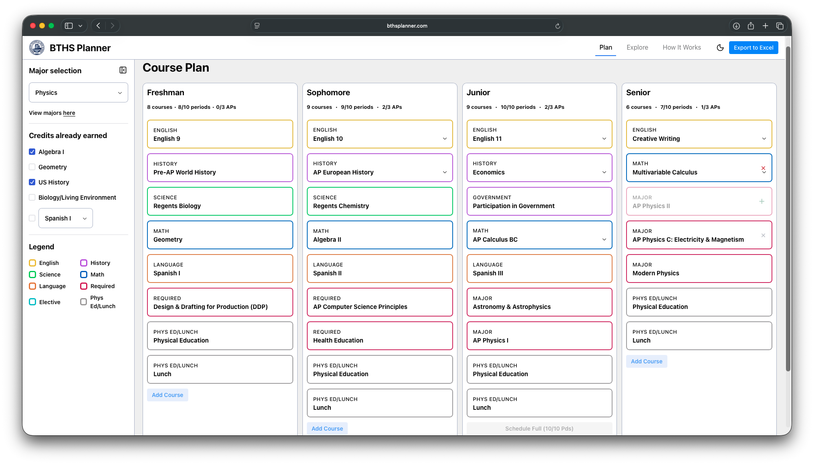
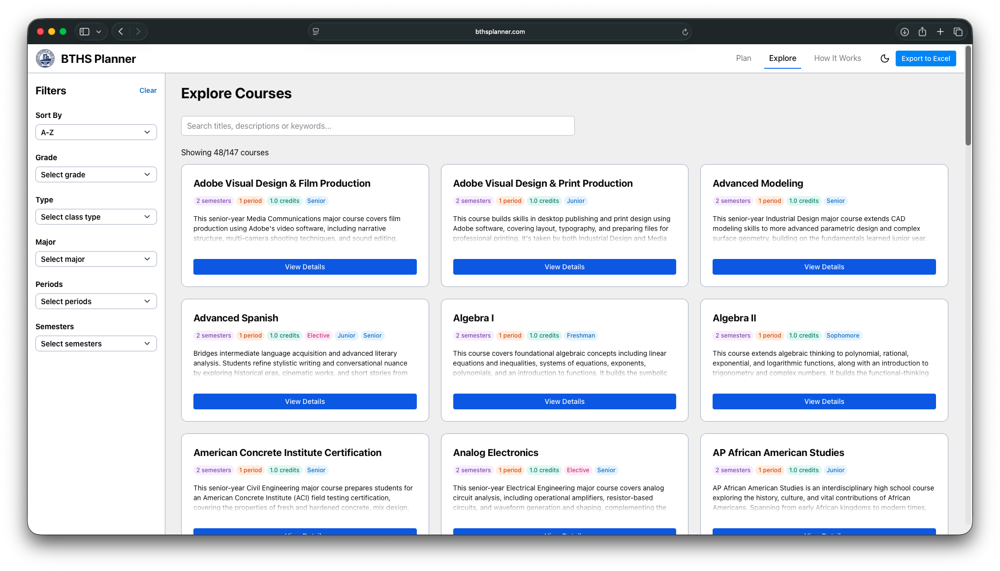

# BTHS Planner

A course planner for Brooklyn Technical High School students to map out all four years of high school in one place.

**Live site:** [bthsplanner.com](https://bthsplanner.com)






## What it does

- **Four-year plan:** pick a major and build out freshman through senior year with dropdowns that only offer courses you can actually take.
- **Conflict handling:** courses you've already taken, major requirements, and AP limits are accounted for, so the options update as you choose.
- **Period and credit tracking:** see how many periods and courses each year adds up to.
- **Explore page:** search the full course catalog (147 courses) and filter by grade, major, type (elective, AP), number of periods, and semesters.
- **Excel export:** download your plan as a spreadsheet.

## Run it locally

You need Python 3.12 and Node.js (Reflex uses it to build the frontend).

```bash
git clone https://github.com/everettwhidden/BTHSPlanner.git
cd BTHSPlanner

python -m venv .venv
source .venv/bin/activate      # Windows: .venv\Scripts\activate

pip install -r requirements.txt
reflex run
```

Then open http://localhost:3000.

## How it's organized

- `bthsplanner/backend/`: the app's logic (planner state, dropdown rules, Explore filtering, Excel export)
- `bthsplanner/components/`: reusable UI pieces (cards, filters, sidebar, modals)
- `bthsplanner/pages/`: one file per page (home, plan, explore, how it works)
- `data/courses/`: the course catalog and major requirements, as plain Python dictionaries

The course catalog and major requirements live in plain Python dictionaries in `data/courses/`, so updating a course description or a major's requirements doesn't touch any app logic.

## Built with

[Reflex](https://reflex.dev), a framework for building web apps in pure Python. Excel export uses [openpyxl](https://openpyxl.readthedocs.io).

## Notes

This is an unofficial student project and isn't affiliated with Brooklyn Technical High School. Course and major information may change, so check with your guidance counselor before finalizing your schedule.